# Experiment Walkthrough: Proposal Advice (p) Condition

*2026-10-28T19:54:16Z by Showboat 0.6.1*
<!-- showboat-id: b0788f1d-a41e-47b8-aa1b-bc4cb1751a51 -->

This walkthrough demonstrates the complete participant experience in the **proposal_advice (p)** condition of the writing experiment, using the **roomDoubleBooking** scenario. In this condition, participants receive directive AI advice (not copy-paste text) while composing an email.

## Step 1: Consent Page

The participant arrives at the study URL and sees the consent form. This page explains the study purpose, time commitment, compensation, and data handling.

```bash
rodney open "http://localhost:3000/study?username=walkthrough-user&condition=p&scenario=roomDoubleBooking&page=consent" && rodney sleep 2 && rodney screenshot walkthroughs/walkthrough-consent.png
```

```output
Writing Task
walkthroughs/walkthrough-consent.png
```

```bash {image}
walkthroughs/walkthrough-consent.png
```

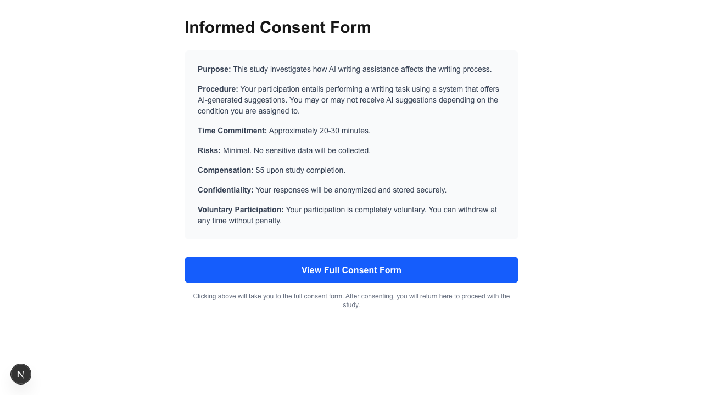

The consent page includes a button that launches an external Qualtrics consent form. After completing consent, the participant is redirected to the introduction page. (For this walkthrough, we navigate directly.)

## Step 2: Introduction Page

The participant sees an overview of the study structure: three steps (questionnaire, email writing task, follow-up questionnaire).

```bash
rodney open "http://localhost:3000/study?username=walkthrough-user&condition=p&scenario=roomDoubleBooking&page=intro" && rodney sleep 2 && rodney screenshot walkthroughs/walkthrough-intro.png
```

```output
Writing Task
walkthroughs/walkthrough-intro.png
```

```bash {image}
walkthroughs/walkthrough-intro.png
```

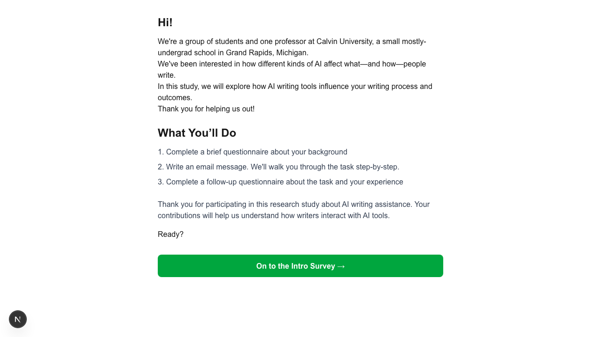

The participant clicks "On to the Intro Survey" to continue.

## Step 3: Intro Survey

A background questionnaire split into five pages, each with a **Next** button (and **Back** after the first page). Required questions must be answered before moving on. The pages are: demographics, email writing experience, AI writing tool usage, the Self-Efficacy for Writing Scale, and the Need for Cognition Scale (NCS-6).

```bash
rodney open "http://localhost:3000/study?username=walkthrough-user&condition=p&scenario=roomDoubleBooking&page=intro-survey" && rodney sleep 2 && rodney screenshot walkthroughs/walkthrough-survey-blank.png
```

```output
Writing Task
walkthroughs/walkthrough-survey-blank.png
```

```bash {image}
walkthroughs/walkthrough-survey-blank.png
```


### Page 1: Demographics

Let's fill in the survey as a sample participant: a university student aged 18-24 whose native language is English.

```bash
rodney click 'input[name="age"][value="18-24"]' && rodney click 'input[name="education"][value="Some college or university, but no degree"]' && rodney click 'input[name="employment"][value="Student"]' && rodney click 'input[name="english_native"][value="Yes"]' && echo "Demographics filled"
```

```output
Clicked
Clicked
Clicked
Clicked
Demographics filled
```

```bash
rodney js "window.scrollTo(0, 0)" && rodney sleep 1 && rodney screenshot walkthroughs/walkthrough-survey-demographics.png
```

```output
null
walkthroughs/walkthrough-survey-demographics.png
```

```bash {image}
walkthroughs/walkthrough-survey-demographics.png
```

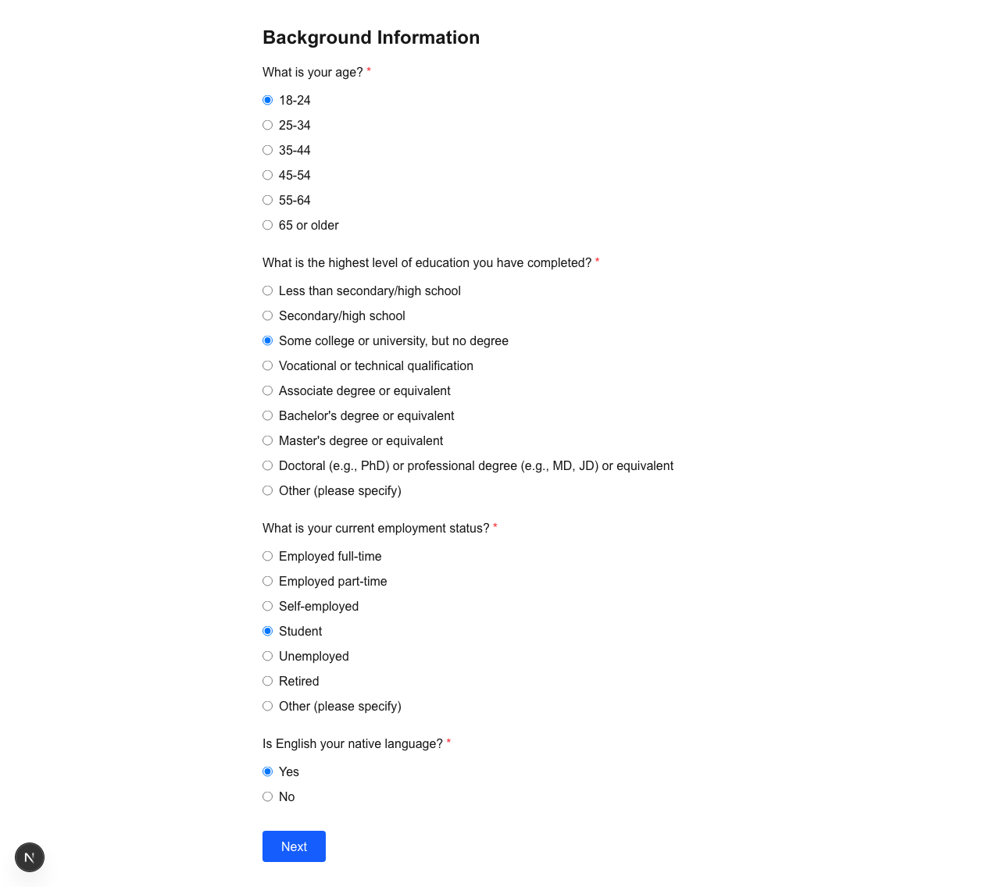

```bash
rodney click 'button[type="submit"]' && rodney sleep 1 && echo "Next page"
```

```output
Clicked
Next page
```

### Page 2: Email Writing Experience

The participant writes emails for school at least weekly and has 1-3 years of experience.

```bash
rodney click 'input[name="email_frequency"][value="At least once a week, but not every day"]' && rodney click 'input[name="email_experience_years"][value="1-3 years"]' && echo "Email writing experience filled"
```

```output
Clicked
Clicked
Email writing experience filled
```

```bash
rodney js "window.scrollTo(0, 0)" && rodney sleep 1 && rodney screenshot walkthroughs/walkthrough-survey-email.png
```

```output
null
walkthroughs/walkthrough-survey-email.png
```

```bash {image}
walkthroughs/walkthrough-survey-email.png
```

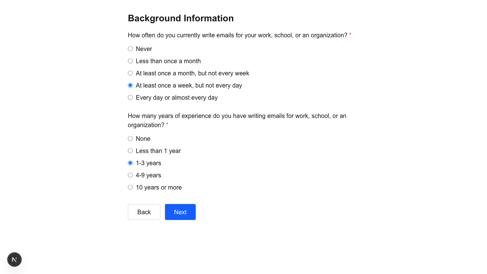

```bash
rodney click 'button[type="submit"]' && rodney sleep 1 && echo "Next page"
```

```output
Clicked
Next page
```

### Page 3: AI Writing Tool Usage

The participant uses AI writing tools monthly, for brainstorming and for revising their own text. Choosing **Other (please specify)** would show a required text box under that option; **I don't use AI for writing** clears the other selections.

```bash
rodney click 'input[name="ai_writing_frequency"][value="At least once a month, but not every week"]' && rodney click 'input[type="checkbox"][value="Brainstorming ideas"]' && rodney click 'input[type="checkbox"][value="Revising or editing text I wrote (including checking for grammar and spelling)"]' && echo "AI writing tool usage filled"
```

```output
Clicked
Clicked
Clicked
AI writing tool usage filled
```

```bash
rodney js "window.scrollTo(0, 0)" && rodney sleep 1 && rodney screenshot walkthroughs/walkthrough-survey-ai-usage.png
```

```output
null
walkthroughs/walkthrough-survey-ai-usage.png
```

```bash {image}
walkthroughs/walkthrough-survey-ai-usage.png
```

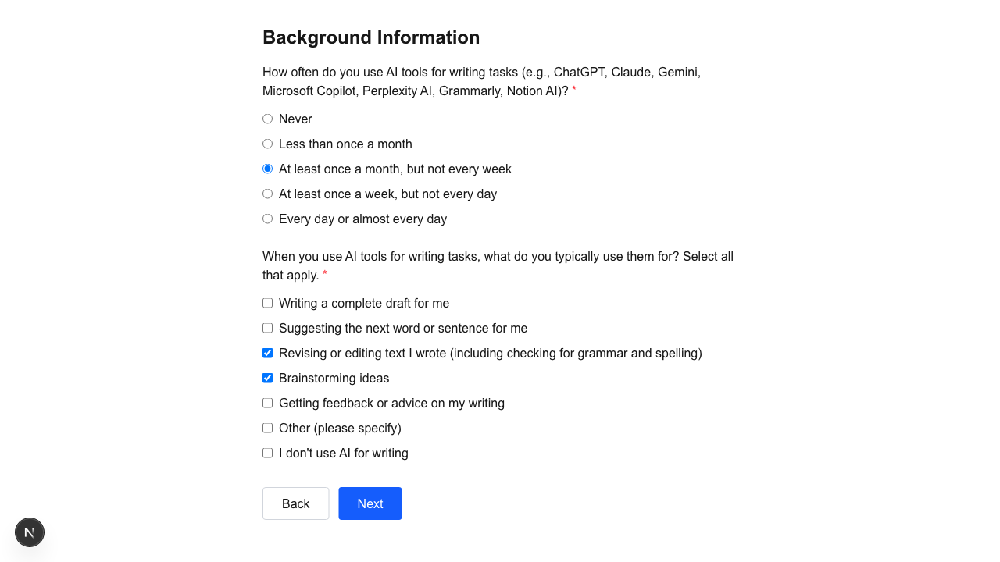

```bash
rodney click 'button[type="submit"]' && rodney sleep 1 && echo "Next page"
```

```output
Clicked
Next page
```

### Page 4: Self-Efficacy for Writing Scale

Nine statements rated from **Not at all confident** to **Extremely confident**.

```bash
rodney click 'input[name="writing_se_words"][value="Very confident"]' && rodney click 'input[name="writing_se_ideas"][value="Moderately confident"]' && rodney click 'input[name="writing_se_put_ideas"][value="Very confident"]' && rodney click 'input[name="writing_se_sentences"][value="Extremely confident"]' && rodney click 'input[name="writing_se_punctuation"][value="Very confident"]' && rodney click 'input[name="writing_se_spelling"][value="Very confident"]' && rodney click 'input[name="writing_se_concentrate"][value="Moderately confident"]' && rodney click 'input[name="writing_se_distractions"][value="Slightly confident"]' && rodney click 'input[name="writing_se_persist"][value="Moderately confident"]' && echo "Self-efficacy questions filled"
```

```output
Clicked
Clicked
Clicked
Clicked
Clicked
Clicked
Clicked
Clicked
Clicked
Self-efficacy questions filled
```

```bash
rodney js "window.scrollTo(0, 0)" && rodney sleep 1 && rodney screenshot walkthroughs/walkthrough-survey-self-efficacy.png
```

```output
null
walkthroughs/walkthrough-survey-self-efficacy.png
```

```bash {image}
walkthroughs/walkthrough-survey-self-efficacy.png
```

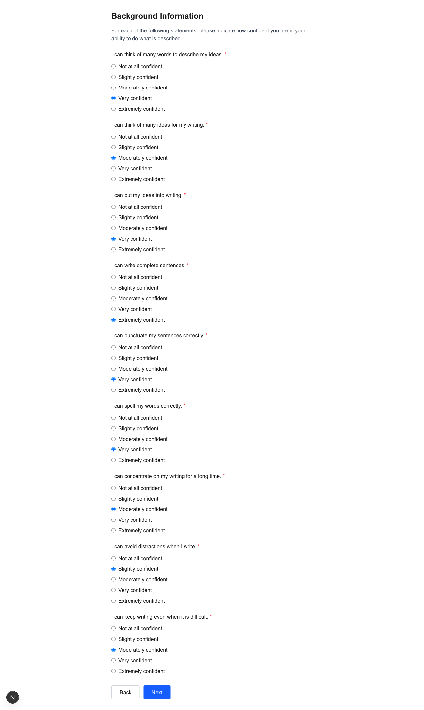

```bash
rodney click 'button[type="submit"]' && rodney sleep 1 && echo "Next page"
```

```output
Clicked
Next page
```

### Page 5: Need for Cognition Scale (NCS-6)

Six statements rated from **Extremely uncharacteristic of me** to **Extremely characteristic of me**.

```bash
rodney click 'input[name="ncs_1"][value="Somewhat characteristic of me"]' && rodney click 'input[name="ncs_2"][value="Somewhat characteristic of me"]' && rodney click 'input[name="ncs_3"][value="Somewhat uncharacteristic of me"]' && rodney click 'input[name="ncs_4"][value="Extremely uncharacteristic of me"]' && rodney click 'input[name="ncs_5"][value="Extremely characteristic of me"]' && rodney click 'input[name="ncs_6"][value="Uncertain"]' && echo "Need for Cognition questions filled"
```

```output
Clicked
Clicked
Clicked
Clicked
Clicked
Clicked
Need for Cognition questions filled
```

```bash
rodney js "window.scrollTo(0, 0)" && rodney sleep 1 && rodney screenshot walkthroughs/walkthrough-survey-ncs.png
```

```output
null
walkthroughs/walkthrough-survey-ncs.png
```

```bash {image}
walkthroughs/walkthrough-survey-ncs.png
```

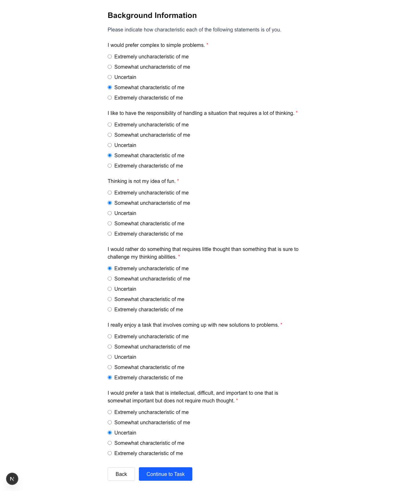

On the last page, the participant clicks "Continue to Task" to proceed.

```bash
rodney click 'button[type="submit"]' && rodney sleep 2 && rodney url
```

```output
Clicked
http://localhost:3000/study?username=walkthrough-user&condition=p&scenario=roomDoubleBooking&page=start-task
```

## Step 4: Task Instructions

The participant reads the scenario briefing. In the roomDoubleBooking scenario, they learn they need to email panelist Jaden Thompson about a room conflict, coordinating with colleague Sarah Martinez via chat. Key instructions include: review colleague's messages, ask follow-up questions, and compose a professional email. They're told they may see an AI Writing Assistant on the right side of the screen.

```bash
rodney js "window.scrollTo(0, 0)" && rodney sleep 1 && rodney screenshot walkthroughs/walkthrough-task-instructions.png
```

```output
null
walkthroughs/walkthrough-task-instructions.png
```

```bash {image}
walkthroughs/walkthrough-task-instructions.png
```

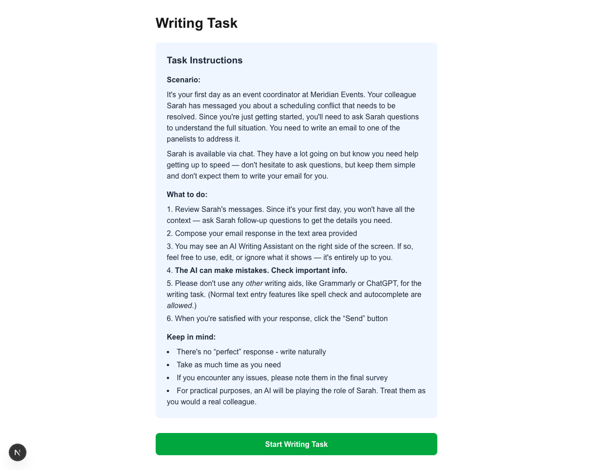

The participant clicks "Start Writing Task" to begin the main task.

```bash
rodney click "button" && rodney sleep 3 && rodney url
```

```output
Clicked
http://localhost:3000/study?username=walkthrough-user&condition=p&scenario=roomDoubleBooking&page=task
```

## Step 5: Main Writing Task

This is the core of the experiment. The screen has three columns:
- **Left sidebar**: Chat with simulated colleague Sarah Martinez
- **Center**: Email composition area (To, Subject, Body fields)
- **Right sidebar**: AI Writing Assistant panel showing directive advice

The colleague's initial messages appear automatically with typing animations.

```bash
rodney sleep 8 && rodney screenshot -w 1440 -h 900 walkthroughs/walkthrough-task-initial.png
```

```output
walkthroughs/walkthrough-task-initial.png
```

```bash {image}
walkthroughs/walkthrough-task-initial.png
```

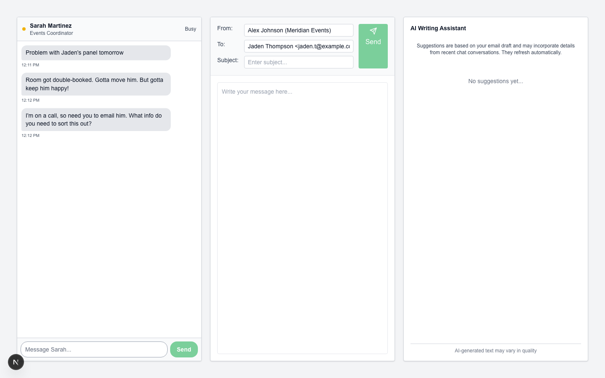

```bash
rodney sleep 10 && rodney screenshot -w 1440 -h 900 walkthroughs/walkthrough-task-messages.png
```

```output
walkthroughs/walkthrough-task-messages.png
```

```bash {image}
walkthroughs/walkthrough-task-messages.png
```


The colleague (Sarah Martinez) sends her initial messages automatically:
1. "Problem with Jaden's panel tomorrow"
2. "Room got double-booked. Gotta move him. But gotta keep him happy!"
3. "I'm on a call, so need you to email him. What info do you need to sort this out?"

The chat is always visible in the left sidebar. The colleague is intentionally non-proactive — she only answers questions when asked, simulating a busy coworker.

### Chatting with the Colleague

The participant asks Sarah questions to gather information needed for the email. She replies only to what's asked.

```bash
rodney input 'input[placeholder="Message Sarah..."]' "What room is Jaden being moved to? And what time is his panel?" && rodney click 'form button[type="submit"]' && echo "Message sent"
```

```output
Typed: What room is Jaden being moved to? And what time is his panel?
Clicked
Message sent
```

```bash
rodney sleep 8 && rodney screenshot -w 1440 -h 900 walkthroughs/walkthrough-task-chat-response.png
```

```output
walkthroughs/walkthrough-task-chat-response.png
```

```bash {image}
walkthroughs/walkthrough-task-chat-response.png
```

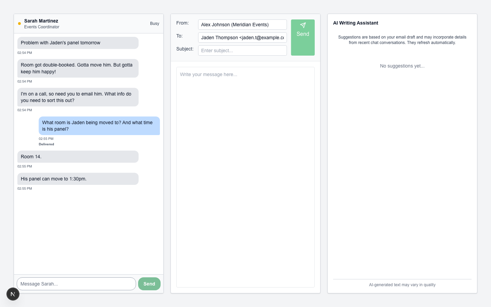

```bash
rodney js "document.querySelector('.flex-1.overflow-y-auto.bg-white').innerText"
```

```output
Problem with Jaden's panel tomorrow
02:54 PM
Room got double-booked. Gotta move him. But gotta keep him happy!
02:54 PM
I'm on a call, so need you to email him. What info do you need to sort this out?
02:54 PM
What room is Jaden being moved to? And what time is his panel?
02:55 PM
Delivered
Room 14.
02:55 PM
His panel can move to 1:30pm.
02:55 PM
```

### Composing the Email

With information from Sarah, the participant begins composing their email. The AI panel requires at least 25 characters before generating suggestions.

```bash
rodney input "#subject-field" "Important Update: Panel Room Change" && echo "Subject entered"
```

```output
Typed: Important Update: Panel Room Change
Subject entered
```

```bash
rodney focus "textarea" && rodney input "textarea" "Dear Jaden,

I hope this message finds you well. I'm writing to let you know about a change to your panel room for tomorrow. Due to a scheduling conflict, we've needed to move your session from the original room to Room 14. The new time slot will be 1:30 PM, which gives us a comfortable setup window.

I understand this is a last-minute change and I apologize for any inconvenience." && echo "Email body entered"
```

```output
Focused
Typed: Dear Jaden,

I hope this message finds you well. I'm writing to let you know about a change to your panel room for tomorrow. Due to a scheduling conflict, we've needed to move your session from the original room to Room 14. The new time slot will be 1:30 PM, which gives us a comfortable setup window.

I understand this is a last-minute change and I apologize for any inconvenience.
Email body entered
```

```bash
rodney screenshot -w 1440 -h 900 walkthroughs/walkthrough-task-email-draft.png
```

```output
walkthroughs/walkthrough-task-email-draft.png
```

```bash {image}
walkthroughs/walkthrough-task-email-draft.png
```

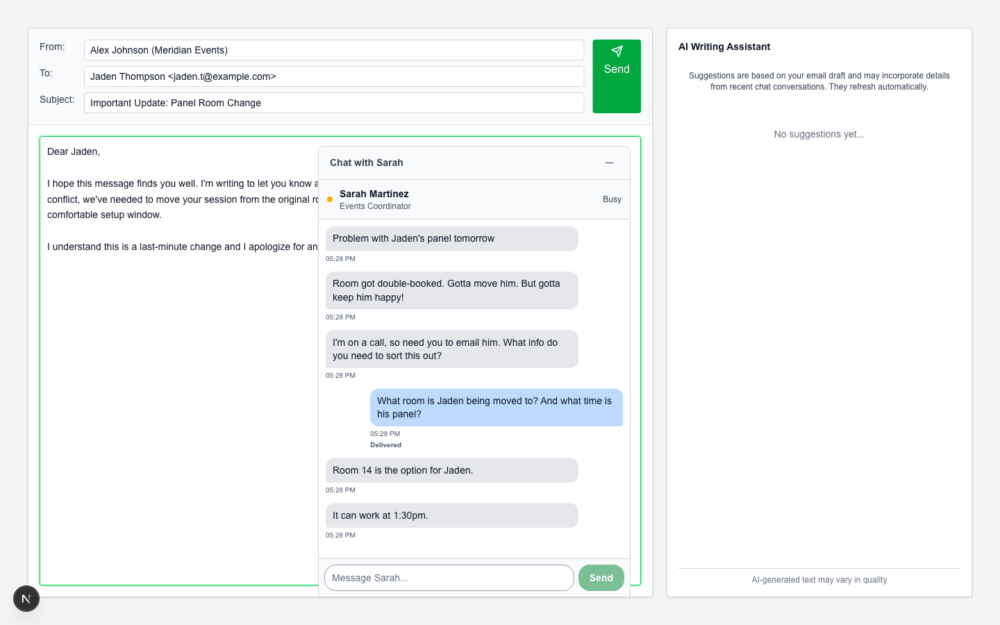

### AI Suggestions Panel (proposal_advice mode)

After the participant types enough text (25+ characters), the AI panel begins generating directive advice. In the **p** condition, the AI provides 2-3 pieces of advice about what to write next — not copy-paste text, but thinking prompts like "Consider acknowledging the inconvenience" or "Emphasize the new arrangement benefits." Suggestions auto-refresh every 15 seconds.

```bash
rodney sleep 18 && rodney screenshot -w 1440 -h 900 walkthroughs/walkthrough-task-ai-suggestions.png
```

```output
walkthroughs/walkthrough-task-ai-suggestions.png
```

```bash {image}
walkthroughs/walkthrough-task-ai-suggestions.png
```

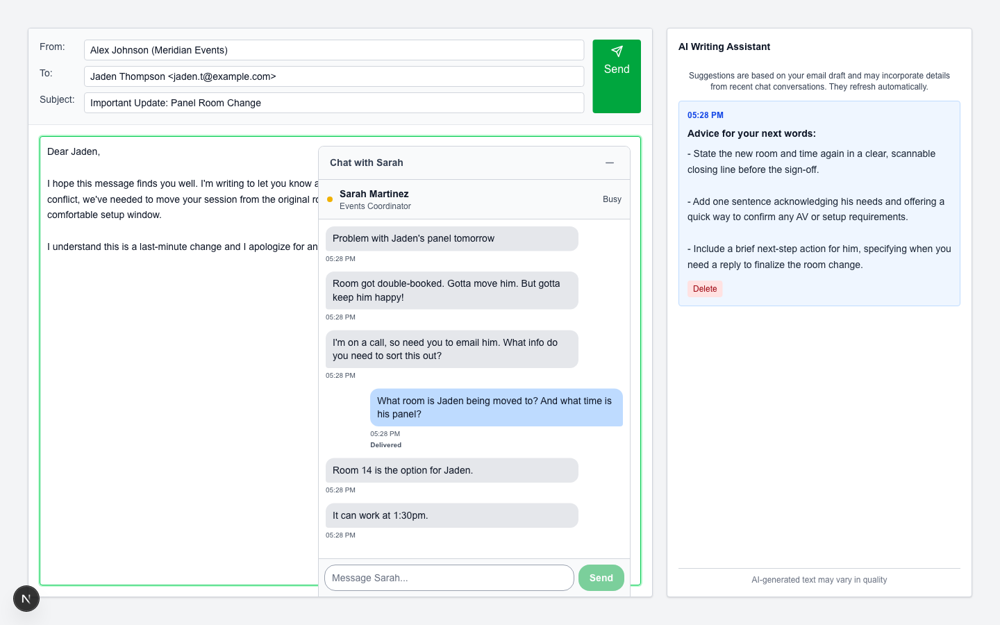

```bash
rodney text "textarea"
```

```output
Dear Jaden,

I hope this message finds you well. I'm writing to let you know about a change to your panel room for tomorrow. Due to a scheduling conflict, we've needed to move your session from the original room to Room 14. The new time slot will be 1:30 PM, which gives us a comfortable setup window.

I understand this is a last-minute change and I apologize for any inconvenience.
```

```bash
rodney js "document.querySelector('h3').parentElement.innerText"
```

```output
AI Writing Assistant
Suggestions are based on your email draft and may incorporate details from recent chat conversations. They refresh automatically.
02:55 PM
Advice for your next words:
- State the key logistics immediately after the apology, including building/location cues and where to check on arrival.

- Add one concrete reassurance about tech/setup support in Room 14 and who will be there to assist.

- End with a clear requested action, such as confirming the new time/room and any special needs.
Delete
AI-generated text may vary in quality
```

The AI panel shows directive advice: it tells the participant *what to think about* rather than giving them words to copy. This is the key distinction of the **p** (proposal_advice) condition compared to other conditions that provide copy-paste text.

Now the participant finishes their email and clicks Send.

```bash
rodney js "document.querySelector('button[aria-label=\"Send email\"]').click()" && rodney sleep 3 && rodney url
```

```output
null
http://localhost:3000/study?username=walkthrough-user&condition=p&scenario=roomDoubleBooking&page=debrief
```

## Step 6: Task Complete

After sending the email, the participant sees a short confirmation page and clicks "Continue to Post-Task Survey".

```bash
rodney screenshot -w 1440 -h 900 walkthroughs/walkthrough-task-complete.png
```

```output
walkthroughs/walkthrough-task-complete.png
```

```bash {image}
walkthroughs/walkthrough-task-complete.png
```

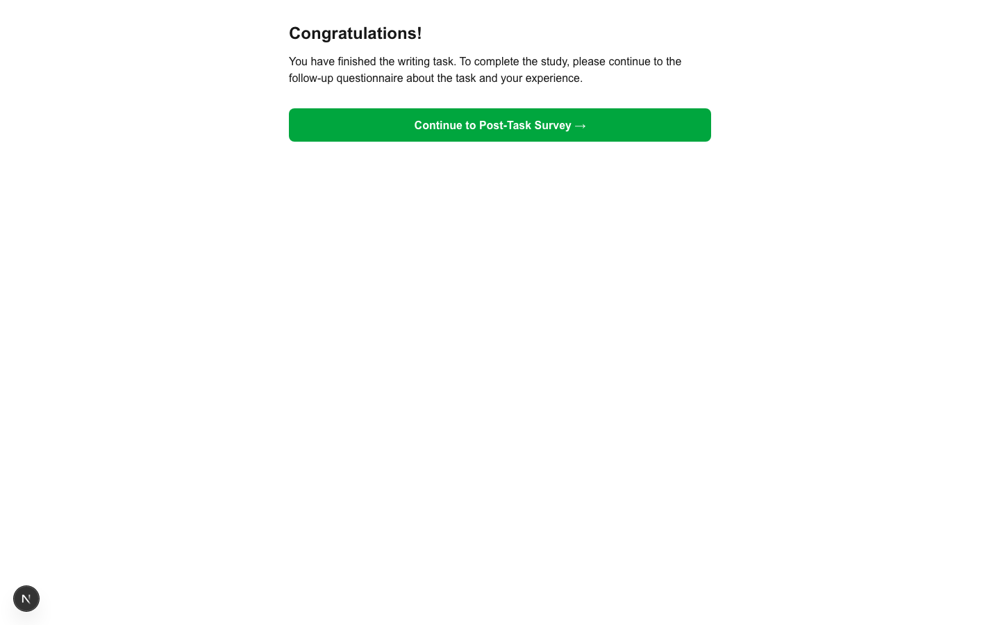

```bash
rodney click "button" && rodney sleep 2 && rodney url
```

```output
Clicked
http://localhost:3000/study?username=walkthrough-user&condition=p&scenario=roomDoubleBooking&page=post-task-survey
```

## Step 7: Post-Task Survey

The post-task survey is split into five pages, each with **Next** and **Back** buttons like the intro survey. The pages are ordered to limit priming: open-ended recall comes first, before any page that names specific concerns or mentions the AI.

1. **General Recall** — what decisions the participant remembers making
2. **Email Feedback** — a micro-task reviewing a colleague's weak draft
3. **Comprehension** — hypothetical follow-up situations
4. **Specific Recall** — whether they remember considering particular concerns
5. **Task Experience** — workload, other tools, and AI-specific questions

### Page 1: General Recall

A single open-ended question asking which decisions the participant made about what to include or leave out, and what influenced each one.

```bash
rodney screenshot walkthroughs/walkthrough-post-survey-general-recall.png
```

```output
walkthroughs/walkthrough-post-survey-general-recall.png
```

```bash {image}
walkthroughs/walkthrough-post-survey-general-recall.png
```

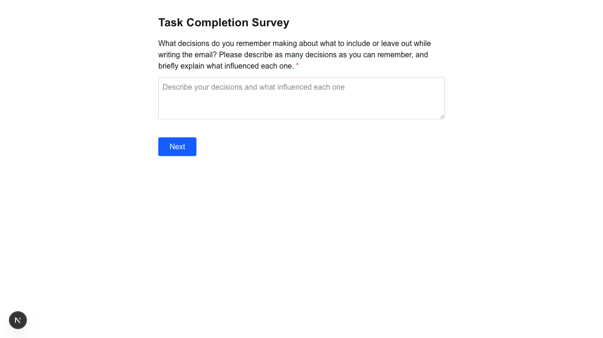

```bash
rodney input "form textarea" "I mentioned the new room number and time first since that is what Jaden needs most. I apologized because Sarah said to keep him happy. I left out why the room was double-booked because it did not seem relevant to him." && rodney click 'button[type="submit"]' && rodney sleep 1 && echo "Next page"
```

```output
Typed: I mentioned the new room number and time first since that is what Jaden needs most. I apologized because Sarah said to keep him happy. I left out why the room was double-booked because it did not seem relevant to him.
Clicked
Next page
```

### Page 2: Email Feedback

The participant imagines a colleague was given the same task and reviews their draft. The draft is deliberately vague and over-apologetic (it never says where or when the panel is moving). Every edit to the feedback box is logged (`surveyInputUpdate`) so large pastes can be detected, and the question reminds participants not to use writing aids.

```bash
rodney screenshot walkthroughs/walkthrough-post-survey-email-feedback.png
```

```output
walkthroughs/walkthrough-post-survey-email-feedback.png
```

```bash {image}
walkthroughs/walkthrough-post-survey-email-feedback.png
```

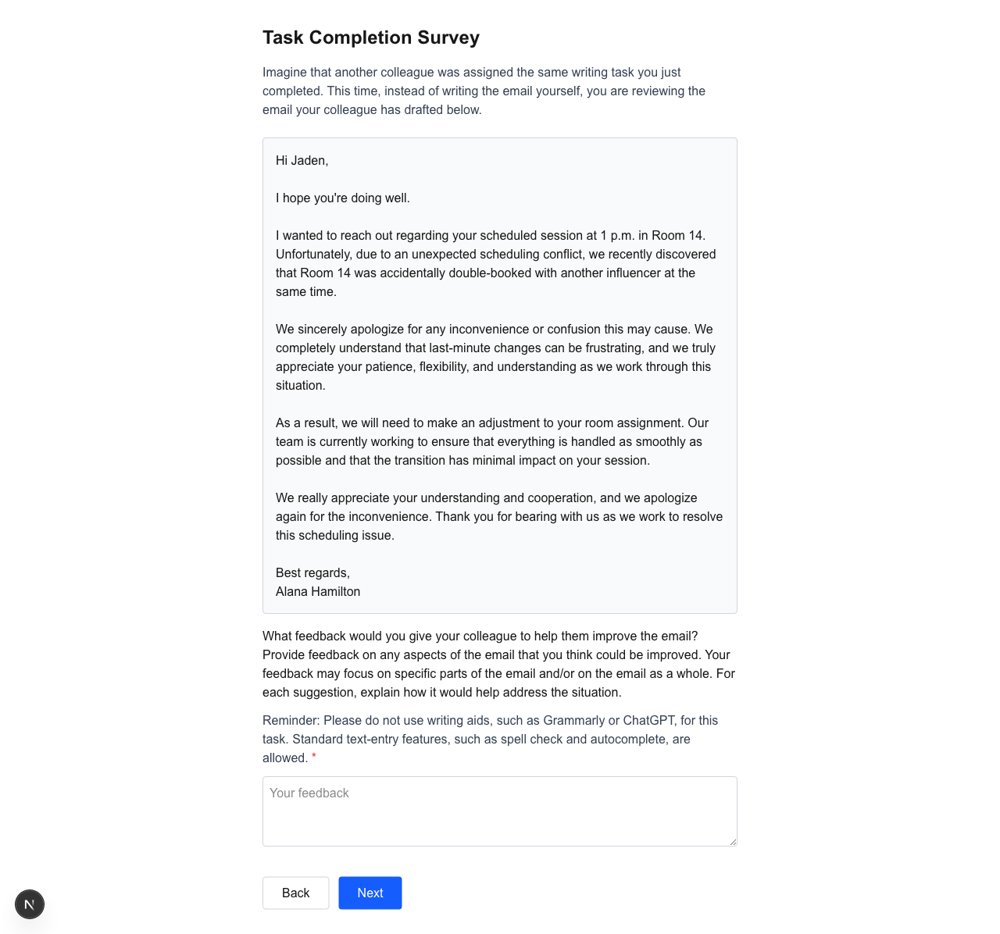

```bash
rodney input "form textarea" "The email never says which room Jaden is moving to or what time, so he cannot act on it. Cut the repeated apologies and add the new details up front so he knows exactly what changed." && rodney click 'button[type="submit"]' && rodney sleep 1 && echo "Next page"
```

```output
Typed: The email never says which room Jaden is moving to or what time, so he cannot act on it. Cut the repeated apologies and add the new details up front so he knows exactly what changed.
Clicked
Next page
```

### Page 3: Comprehension

Three open-ended questions about hypothetical situations after the email is sent: how to respond to a request from the recipient, what reactions the recipient might have, and what the participant would need to know if new information came up. Each question is treated independently.

```bash
rodney screenshot walkthroughs/walkthrough-post-survey-comprehension.png
```

```output
walkthroughs/walkthrough-post-survey-comprehension.png
```

```bash {image}
walkthroughs/walkthrough-post-survey-comprehension.png
```

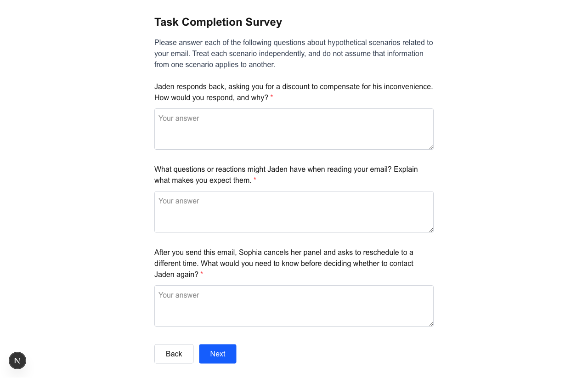

```bash
rodney input 'form .space-y-6 > div:nth-child(1) textarea' "I would check with Sarah before promising anything, since I do not know our policy on discounts." && rodney input 'form .space-y-6 > div:nth-child(2) textarea' "He may ask whether the new room has the same equipment and whether attendees will be told about the change." && rodney input 'form .space-y-6 > div:nth-child(3) textarea' "I would need to know whether Room 12 becomes free at his original time and whether moving back would cause more confusion." && rodney click 'button[type="submit"]' && rodney sleep 1 && echo "Next page"
```

```output
Typed: I would check with Sarah before promising anything, since I do not know our policy on discounts.
Typed: He may ask whether the new room has the same equipment and whether attendees will be told about the change.
Typed: I would need to know whether Room 12 becomes free at his original time and whether moving back would cause more confusion.
Clicked
Next page
```

### Page 4: Specific Recall

Ten scenario-specific concerns (two of which, band setup and hotel housekeeping, obviously do not fit the scenario), each answered **Yes, I remember considering this**, **I'm not sure**, or **No, I don't remember considering this**.

```bash
for key in room_12_to_14 room_double_booked new_room_1pm_conflict; do rodney click "input[name=\"specific_recall_$key\"][value=\"Yes, I remember considering this\"]"; done && for key in already_advertised reliability_confidence; do rodney click "input[name=\"specific_recall_$key\"][value=\"I'm not sure\"]"; done && for key in band_setup_time delay_conflicts_commitments new_room_readiness housekeeping_cleaning panel_less_important; do rodney click "input[name=\"specific_recall_$key\"][value=\"No, I don't remember considering this\"]"; done && echo "Specific recall filled"
```

```output
Clicked
Clicked
Clicked
Clicked
Clicked
Clicked
Clicked
Clicked
Clicked
Clicked
Specific recall filled
```

```bash
rodney js "window.scrollTo(0, 0)" && rodney sleep 1 && rodney screenshot walkthroughs/walkthrough-post-survey-specific-recall.png
```

```output
null
walkthroughs/walkthrough-post-survey-specific-recall.png
```

```bash {image}
walkthroughs/walkthrough-post-survey-specific-recall.png
```

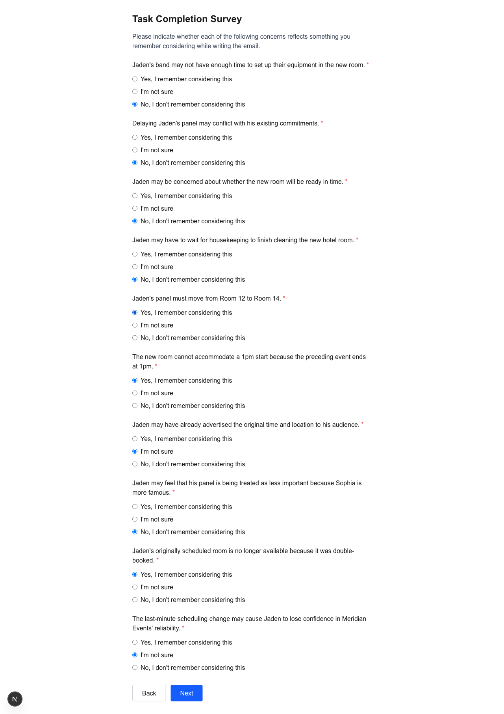

```bash
rodney click 'button[type="submit"]' && rodney sleep 1 && echo "Next page"
```

```output
Clicked
Next page
```

### Page 5: Task Experience

Only this last page reveals the condition: a callout explains what the AI provided (for **p**, "About the AI Advice"). Below it are NASA TLX-style workload questions, which other tools were used, technical difficulties, and AI-specific questions about the AI Writing Assistant (a moment they decided not to use something it showed, whether its output was easy to understand and helpful, whether they felt pressured to use it, and a free-text description). The no-AI condition gets only the common questions.

```bash
rodney click 'input[name="tlx_mental_demand"][value="Medium"]' && rodney click 'input[name="tlx_temporal_demand"][value="Low"]' && rodney click 'input[name="tlx_performance"][value="Good"]' && rodney click 'input[name="tlx_physical_demand"][value="Very Low"]' && rodney click 'input[name="tlx_effort"][value="Medium"]' && rodney click 'input[name="tlx_frustration"][value="Low"]' && echo "TLX questions filled"
```

```output
Clicked
Clicked
Clicked
Clicked
Clicked
Clicked
TLX questions filled
```

```bash
rodney click 'input[name="ai_ease_understand"][value="Agree"]' && rodney click 'input[name="ai_helpful"][value="Agree"]' && rodney click 'input[name="ai_felt_pressured"][value="Disagree"]' && rodney click 'input[name="ai_think_carefully"][value="Agree"]' && echo "AI questions filled"
```

```output
Clicked
Clicked
Clicked
Clicked
AI questions filled
```

```bash
rodney click 'input[value="None"]' && echo "Other tools: None"
```

```output
Clicked
Other tools: None
```

```bash
rodney js "window.scrollTo(0, 0)" && rodney sleep 1 && rodney screenshot walkthroughs/walkthrough-post-survey-task-experience.png
```

```output
null
walkthroughs/walkthrough-post-survey-task-experience.png
```

```bash {image}
walkthroughs/walkthrough-post-survey-task-experience.png
```

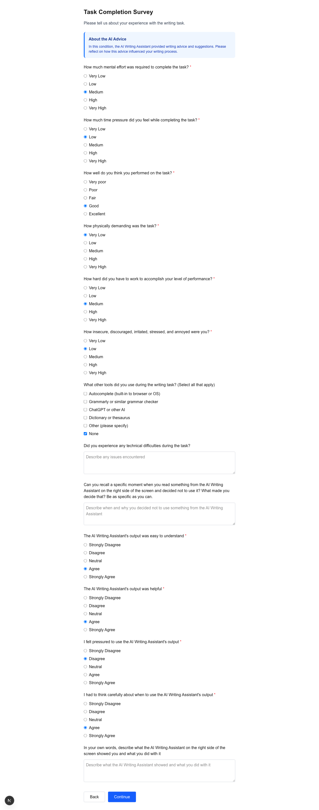

The participant clicks "Continue" to submit the survey.

```bash
rodney click 'button[type="submit"]' && rodney sleep 2 && rodney url
```

```output
Clicked
http://localhost:3000/study?username=walkthrough-user&condition=p&scenario=roomDoubleBooking&page=final
```

## Step 8: Final Page

The study is complete. The participant sees a thank-you message and, if recruited via Prolific, a completion code for payment.

```bash
rodney screenshot -w 1440 -h 900 walkthroughs/walkthrough-final.png
```

```output
walkthroughs/walkthrough-final.png
```

```bash {image}
walkthroughs/walkthrough-final.png
```

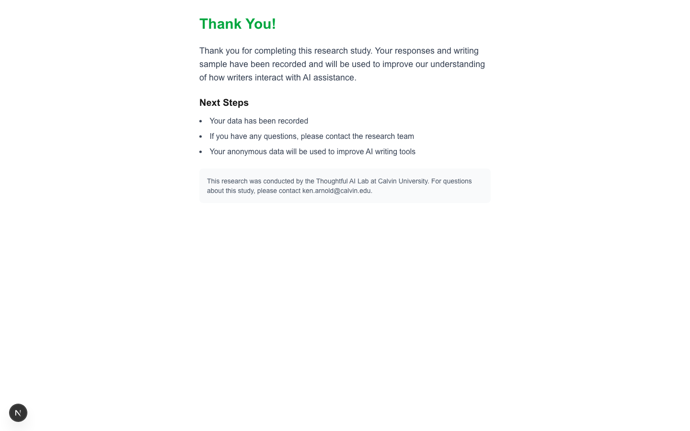

```bash
rodney text "body" 2>/dev/null | head -20
```

```output
Thank You!

Thank you for completing this research study. Your responses and writing sample have been recorded and will be used to improve our understanding of how writers interact with AI assistance.

Next Steps
Your data has been recorded
If you have any questions, please contact the research team
Your anonymous data will be used to improve AI writing tools

This research was conducted by the Thoughtful AI Lab at Calvin University. For questions about this study, please contact ken.arnold@calvin.edu.
```

## Summary

The **proposal_advice (p)** condition walkthrough is complete. The participant experienced:

1. **Consent** — Study information and IRB consent form
2. **Introduction** — Overview of the three study phases
3. **Intro Survey** — Five pages: demographics, email writing experience, AI writing tool usage, writing self-efficacy, and Need for Cognition
4. **Task Instructions** — Scenario briefing (room double-booking, email to Jaden Thompson)
5. **Main Task** — Email composition with:
   - Chat with non-proactive colleague Sarah Martinez
   - AI Writing Assistant providing **directive advice** (not copy-paste text)
   - Auto-refreshing suggestions every 15 seconds
6. **Task Complete** — Confirmation page before the post-task survey
7. **Post-Task Survey** — Five pages: general recall, email feedback micro-task, comprehension, specific recall, and task experience (workload + AI-specific reflection)
8. **Completion** — Thank you and Prolific code

The key feature of the **p** condition: AI advice guides *thinking* rather than *writing*. Suggestions like "Add the building name for Room 14" and "End with a confirmation request" prompt deeper engagement without providing verbatim text to copy.

```bash
rodney stop
```

```output
Chrome stopped
```
